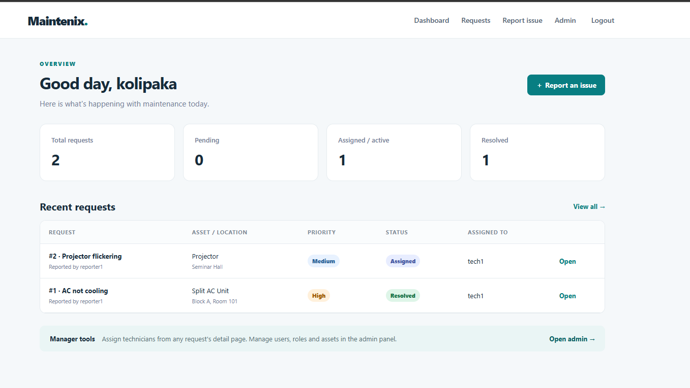
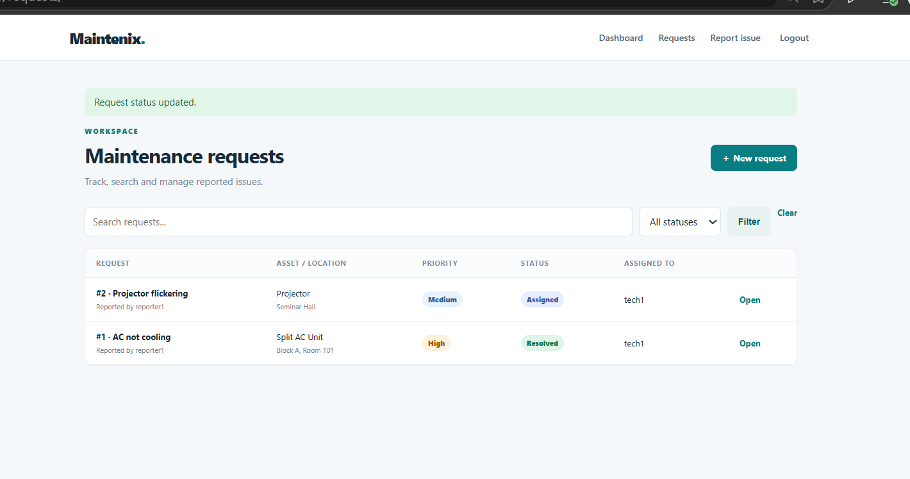
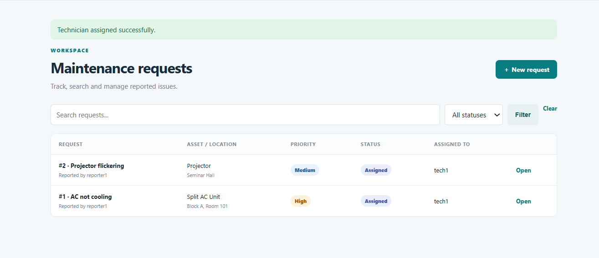
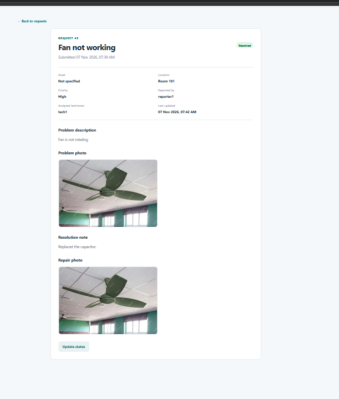

# Maintenix

A role-based maintenance request management system built with **Django**. Reporters raise issues, managers assign technicians, and technicians update progress until the request is resolved.

## Features
- **Four user roles:** Reporter, Technician, Manager and Admin, with role-based access control
- **Report issues** with asset, location, priority and description
- **Photo attachments:** reporters attach a photo of the problem and technicians a photo of the repair (JPG/PNG/WebP, max 5 MB, validated)
- **Assign technicians** (managers and admins only)
- **Update status** (Assigned, In progress, Resolved); a resolution note is required to resolve a request
- **Dashboard** with live counts for total, pending, active and resolved requests
- **Search and filter** requests by keyword and status
- **Asset register** and user/role management through the Django admin panel
- **Automated tests:** 14 tests covering role permissions, status rules and photo upload validation
- SQLite by default, optional MySQL support

## Screenshots
### Dashboard


### Requests list


### Request detail


### Photo attachments


## Tech stack
Python, Django, SQLite / MySQL, HTML, CSS

## How to run
```bash
git clone https://github.com/meghana-kolipaka/maintenix_complete_project.git
cd maintenix_complete_project
python -m venv venv
venv\Scripts\activate          # Windows
pip install -r requirements.txt
python manage.py migrate
python manage.py seed_demo     # demo users and sample requests
python manage.py createsuperuser
python manage.py runserver
```
Open http://127.0.0.1:8000/

### Demo logins (created by `seed_demo`)
| Username | Role | Password |
|---|---|---|
| reporter1 | Reporter | demo12345 |
| tech1 | Technician | demo12345 |
| manager1 | Manager | demo12345 |

Superusers created with `createsuperuser` automatically get the Admin role.

## Run the tests
```bash
python manage.py test
```

## Workflow
1. A reporter submits a request, optionally with a photo of the problem.
2. A manager or admin assigns it to a technician.
3. The technician sets it to In progress, then Resolved with a resolution note and an optional repair photo.

## Author
Kolipaka Meghana: [LinkedIn](https://www.linkedin.com/in/kolipaka-meghana-6603b8301) · [GitHub](https://github.com/meghana-kolipaka)